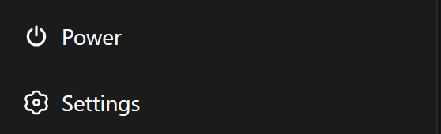
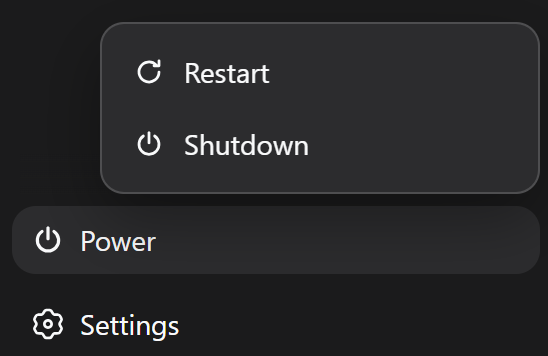
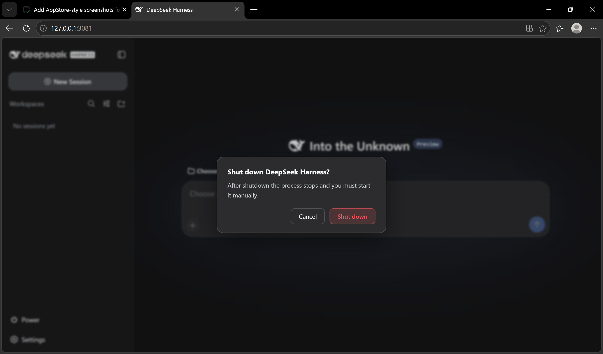
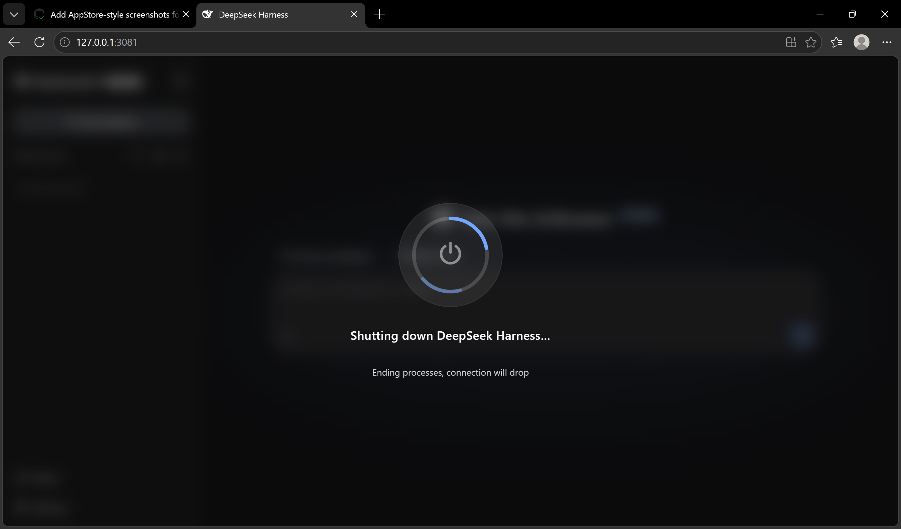

# dsh-power-button

[](LICENSE)
[](https://github.com/deepseek-ai/DeepSeek-Harness)

[English](README.md) | [中文](README.zh-CN.md)

A self-contained **power & lifecycle controller** for [DeepSeek Harness](https://github.com/deepseek-ai/DeepSeek-Harness): a sidebar power button with a Restart / Shutdown menu and a full-screen transition overlay. The restart engine is built in — no third-party dependencies.

> Developed with DeepSeek AI assistance; reviewed before release.

## Features

- **Sidebar power button** in the footer action slot, theme-aware and styled to match the adjacent Settings trigger.
- **Restart / Shutdown menu** with a Windows-style full-screen overlay; the page reloads by itself after a confirmed restart.
- **Self-contained restart engine**: a detached `.cjs` helper takes over relaunching DSH through an ARM → COMMIT → ACK handshake, waits for the old process, the port and the session logs, then relaunches the same invocation in the same cwd. A `--port 0` command line is pinned to the port the old process actually bound. No PowerShell, no `taskkill`.
- **`/restart` and `/shutdown` commands**, a **`restart_harness` model tool** (registration is skipped when another plugin already owns the name), and a read-only **`restart_status`** tool for checking whether a restart happened.
- **Localized UI and host notices** (zh / en), following the profile's `locale.preference`.
- **Startup housekeeping**: helper logs and scripts, per-restart handshake records, and undelivered notices older than 7 days are pruned from the runtime directory.

## Screenshots

**① Sidebar power button** — theme-aware footer entry.



**② Restart / Shutdown menu** — two actions, one click away.



**③ Shutdown confirm dialog** — the default focus sits on **Cancel**; only an explicit confirm stops the process.



**④ Shutdown progress overlay** — shows the current stage while the process winds down.



**⑤ Restart completed toast** — after the auto reload, a notice confirms DSH is back.


## Install

```sh
dsh plugin --profile web add "github:keyiadiannao/dsh-power-button#master"
```

Restart DSH; a power button appears in the sidebar footer. Requires Node ≥ 22.19.

## Configuration

Configured through the profile's cordis layer (`cordis.patch.yml` or the settings UI):

| Key | Default | Meaning |
|---|---|---|
| `enableModelTool` | `true` | Register the `restart_harness` model tool. Set `false` to keep restart on the GUI button and `/restart` only. |
| `maxDelayMs` | `5000` | Upper bound (ms) for the model tool's `delayMs`. The effective floor is 1000 ms. |
| `restartWakeMode` | `quiet` | What the session that asked for a restart is told afterwards. `quiet` stages the notice for its next step without waking anything; `notify` also wakes that session once it is live, so the model reports the restart without a user message. Neither mode restarts anything on its own. |

```yaml
- id: dsh-power-button
  config:
    enableModelTool: true
```

## How it works

Restart is an explicit ARM → COMMIT → ACK handshake. The old process does not exit until a live successor owns the relaunch, because an exit with nobody left to relaunch is the one outcome the UI cannot recover from — every failure before the ACK keeps the old process running.

```
click power → Restart
[host]    POST /api/dsh-power-button/restart
          write the per-restart helper .cjs (0600: it embeds the relaunch argv)
          spawn `node <helper>` detached
[helper]  ARM  → status { stage: 'armed' }
[host]    wait for ARMED (5 s), then write the COMMIT file for this restartId
[helper]  ACK  → status { stage: 'committed' }
[host]    only now: unref the helper, flush live sessions (≤5 s),
          request exit after delayMs with a 15 s watchdog behind it
[helper]  wait for the old PID to exit, the port to free, the session logs to settle
          write the v2 marker, then spawn DSH with the same invocation and cwd
          poll /health until instanceId differs and restart.restartId matches
[client]  reload
```

Four invariants hold this together:

- The helper lives **outside the process tree** (`detached`, a real `.cjs` file — a multi-line `node -e` is mangled by Windows `CreateProcess`), so terminating DSH cannot kill it mid-flight.
- Success is confirmed by a per-process `instanceId` that must **change**, so a brief outage never fakes it.
- The launcher's exit channel is read at `ctx.get('appExit')`, never as a property: it is an optional host service this plugin does not inject, and a property read resolves to `undefined` — which would skip graceful disposal and hard-kill instead.
- Exit is bounded end to end, and the bounds are **derived rather than duplicated**: graceful exit gets a 15 s watchdog, the pre-exit flush cap is 5 s, and the helper's patience for the old PID is computed from both, so they cannot drift into the helper giving up first.

Shutdown posts `/api/dsh-power-button/shutdown` and stops without relaunching. It is irreversible, so the button and `/shutdown` both open a confirm dialog; the model is never given shutdown.

## Safety

- Destructive POSTs go through **the deployment's own browser-trust fence and authentication** via `ctx.connection.requestRejection` — the call the host's `/api` route uses. `/api/dsh-power-button/*` is longer than the official `/api` prefix, so longest-prefix matching never routes these requests through that fence; delegating keeps them under the operator's real policy, including LAN authorities derived from an all-interface bind and any `trustedHosts` / `--trusted-host` declaration.
- On a host with no connection service (a profile without the web bundle) the plugin falls back to its own rules: `Host` must be a loopback authority or one the host declared, plus the cross-site and full-authority `Origin` checks. That fallback is narrower than the official fence and can only refuse; it does **not** provide browser-session authentication.
- A refusal answers with a stable `reason` code and logs the observed `Host` / `Origin` / `sec-fetch-site` / remote address. `host-fence` and `not-authenticated` mean the deployment decided, not this plugin.
- An **at-most-once latch** rejects duplicate transitions, so a concurrent second POST gets `409`.
- The model tool's `delayMs` is **floored at 1000 ms** — the model cannot kill the process before its own turn settles.
- The restart marker is **consumed on boot**, so a later ordinary launch never misreports a restart. Command lines are **redacted** in logs; helper and marker files are written `0600`, the runtime directory `0700`.

## Restart awareness

Three audiences, deliberately not one:

- **The UI** shows a localized "Restarted" toast. The restart identity stays on `/health` for the process's whole life; acknowledging the toast clears only the pending flag.
- **The session that asked** gets a notice shaped by `restartWakeMode` — `Agent.inject()` when `quiet`, `Agent.followup()` when `notify`. Only a restart with a recorded causal session gets one: a GUI click records none and is never attributed to whichever conversation happens to be open. At most one notice per session is queued and it is deleted once delivered.
- **Every other session** can call `restart_status`, which reports whether a restart happened, its id, stage, the instances involved, timings, who asked, and whether the running process is the instance that restart produced.

The plugin never appends a model-visible event and never forges a turn: awareness is handed to the Agent API, whose `inject()` durably stages an `agent/inbox/spliced` record for the next legitimate step. Delivery is once per notice in normal operation; a crash between the inbox write and the deletion can repeat it, and the notice text is written so a repeat is harmless.

`/health` also reports `appExit: "available" | "missing"` — whether the launcher-provided exit channel actually resolves here, which turns a delayed restart into a one-request diagnosis. Both exit paths log the pre-exit flush tally (`live` / `fulfilled` / `rejected` / `timedOut`), so a refused or partial durable write is visible afterwards instead of looking like a clean exit.

## Development

```sh
pnpm build            # tsdown: host + client bundle (committed to lib/)
pnpm typecheck        # tsc --noEmit over src
pnpm typecheck:tests  # the root tsconfig excludes tests/
pnpm test             # vitest: unit + process-level acceptance
pnpm check            # all of the above, in order
```

CI runs on Windows, Ubuntu and macOS: both typechecks, tests, build, a gate that the committed `lib/` matches a fresh build byte for byte (a git install runs those artifacts), and a `pnpm pack` check that the tarball contains `lib/` and `cordis.patch.yml`. A separate Linux job repeats the steps on Node **22.19**, the floor `engines.node` declares.

`tests/restart-runtime.spec.ts` executes the exact helper the host generates as a real process against real TCP ports, and pins what unit tests cannot: the full relaunch chain, no relaunch without COMMIT, bounded spawn retries, the health gate refusing a stale instance, a `--port 0` successor landing on the bound port, and the failure diagnoses (`marker-write-failed`, a still-moving session log). Tests isolate `DSH_HOME` via a vitest setup file, so they never touch your real `~/.dsh`.

## License & Attribution

MIT. The "detached helper relaunch" idea follows [anweat/dsh-restart](https://github.com/anweat/dsh-restart) (MIT); the implementation is independently written (real `.cjs` file, no PowerShell, dynamic port), no code copied.
