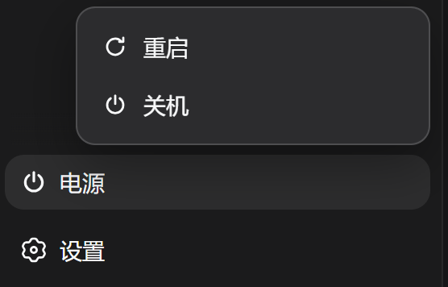
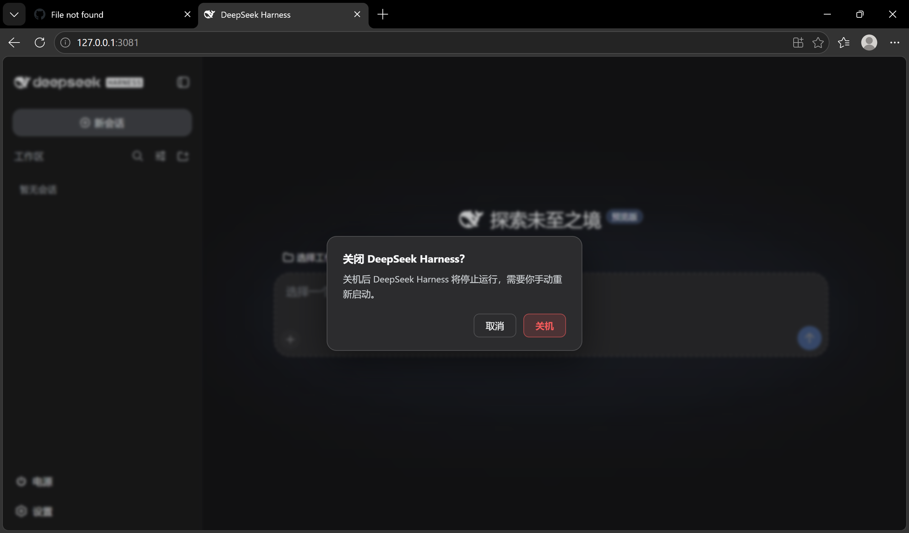
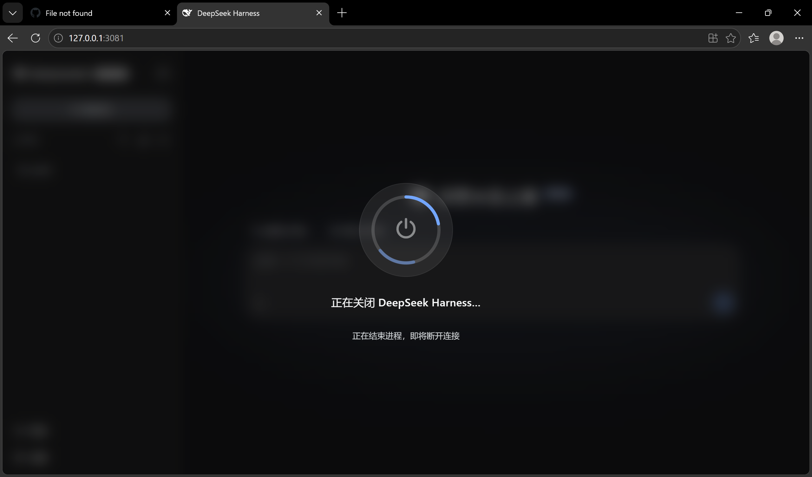

# dsh-power-button

[](LICENSE)
[](https://github.com/deepseek-ai/DeepSeek-Harness)

[English](README.md) | [中文](README.zh-CN.md)

[DeepSeek Harness](https://github.com/deepseek-ai/DeepSeek-Harness) 的自包含**电源与生命周期控制**插件：侧边栏底部**电源按钮** + 上拉**重启/关机**菜单 + 全屏过渡动画。重启引擎内置在本插件中，**不依赖第三方插件**。

> 由 DeepSeek AI 辅助开发，发布前经人工 review。

## 功能

- **侧边栏电源按钮**：注册到页脚操作位（`sidebar.footer.action`），主题自适应，外观与旁边的"设置"按钮一致
- **重启/关机菜单** + Windows 关机风格全屏过渡；重启确认后页面自动刷新
- **自包含重启引擎**：写一个 detached 的 `.cjs` helper，经 ARM → COMMIT → ACK 握手接手拉起职责，等旧进程、端口与会话日志都落定后，以相同调用方式与原目录重新拉起 DSH；`--port 0` 命令行会被固定为本进程实际绑定的端口。不使用 PowerShell、不使用 `taskkill`
- **`/restart` 与 `/shutdown` 命令**、**`restart_harness` 模型工具**（名字已被其它插件占用时跳过注册），以及只读的 **`restart_status`** 诊断工具
- **界面与宿主文案本地化**（中文 / English），跟随 profile 的 `locale.preference`
- **启动清理**：自动清理运行目录下超过 7 天的 helper 日志与脚本、每次重启的握手记录，以及尚未投递的通知

## 截图

**① 侧边栏电源按钮** —— 主题适配的底部常驻入口。


**② 重启 / 关机菜单** —— 两个动作一次到位。



**③ 关机确认对话框** —— 默认焦点在「取消」，只有显式确认才会停止进程。



**④ 关机进度遮罩** —— 进程收尾时显示当前阶段。



**⑤ 重启完成提示** —— 页面自动重载后确认 DSH 已恢复。


## 安装

```sh
dsh plugin --profile web add "github:keyiadiannao/dsh-power-button#master"
```

重启 DSH 后生效：侧边栏底部出现电源按钮。需要 Node ≥ 22.19。

## 配置

通过 profile 的 cordis 层配置（`cordis.patch.yml` 或设置界面）：

| 键 | 默认 | 含义 |
|---|---|---|
| `enableModelTool` | `true` | 注册 `restart_harness` 模型工具。设 `false` 则重启仅保留在 GUI 按钮与 `/restart`。 |
| `maxDelayMs` | `5000` | 模型工具 `delayMs` 参数的上限（ms）。有效下限为 1000 ms。 |
| `restartWakeMode` | `quiet` | 重启后如何告知**发起它的那个会话**。`quiet` 只把通知暂存给它的下一个 step，不唤醒任何东西；`notify` 额外在该会话变成 live 后唤醒它，模型无需用户发消息即可报告结果。两种模式都不会自行再次重启。 |

```yaml
- id: dsh-power-button
  config:
    enableModelTool: true
```

## 工作原理

重启是一次显式的 ARM → COMMIT → ACK 握手。旧进程在有一个存活的继任者接手拉起职责之前不得退出——没有任何进程负责拉起是 UI 唯一无法挽回的结果，因此 ACK 之前的任何失败都会让旧进程继续运行。

```
点击电源 → 重启
[宿主]   POST /api/dsh-power-button/restart
         写出本次重启专用的 helper .cjs（0600：内嵌拉起 argv）
         spawn `node <helper>` detached
[助手]   ARM  → status { stage: 'armed' }
[宿主]   等到 ARMED（5 秒），写入本次 restartId 的 COMMIT 文件
[助手]   ACK  → status { stage: 'committed' }
[宿主]   此时才：unref helper → flush 活跃会话（≤5 秒）
         → delayMs 后请求退出，其后有 15 秒看门狗
[助手]   等旧 PID 退出、端口释放、会话日志落定
         写 v2 marker，用相同 execPath/argv/cwd 拉起 DSH
         轮询 /health 直到 instanceId 变化且 restart.restartId 匹配
[客户端] 自动刷新
```

四条不变量支撑这套流程：

- helper 必须**脱离进程树**（`detached` + 真实 `.cjs` 文件——多行 `node -e` 会被 Windows `CreateProcess` 破坏），否则终止 DSH 时 helper 一起被杀
- 重启成功以**每次进程独立的 `instanceId` 变化**为准，短暂离线本身不算成功
- 启动器的退出通道在 `ctx.get('appExit')` 读取，**不能当属性读**：它是本插件未在 `inject` 中声明的可选宿主服务，按属性读会得到 `undefined`，从而跳过优雅销毁、直接硬杀
- 退出全链有界，且**边界是推导出来的而非各写一份**：优雅退出 15 秒看门狗、退出前 flush 上限 5 秒，helper 等旧 PID 的耐心由两者计算而来，避免日后漂移成"helper 先放弃"
- 新进程的环境**从注册表重新读取**，而不是继承：进程环境是启动器创建时的快照，否则用 `setx` 或系统属性改过的变量永远到不了重启后的实例。环境块按 Windows 的顺序组合——以继承块为**底层**，系统值覆盖其上，用户值再覆盖系统值——`REG_EXPAND_SZ` 只对它自己那一阶段可见的变量展开，因此系统值看不到仅用户存在的名字。这种隔离是**注册表层之间**的隔离，不是逐字节复现 Windows 构建环境块的过程：启动器原有进程块里的名字在每一阶段都可见——这是刻意的，因为其中有些（本机上的 `SystemRoot`）只存在于进程环境里。`PATH` 保留两半（系统在前），每段按各自类型展开后再去重。读取走 `reg export`（UTF-16LE），非 ASCII 值在任何控制台代码页下都能保真；导出文件是 harness home 下的临时文件，同一次调用内删除，它继承该目录的 ACL——和 `.credentials.yaml` 完全一样，**在 Windows 上文件模式并不构成隐私保证**。从注册表**删除**的变量仍然看不到；从注册表 `PATH` 里删掉、但启动器进程块里仍有的目录也会保留——它和"包管理器在启动时注入的目录"无法区分，丢掉后者会让按名字解析工具的子进程直接失败。非 Windows 平台保持纯继承

关机 POST `/api/dsh-power-button/shutdown`，终止且不拉起。由于不可逆，电源按钮和 `/shutdown` 都会先弹确认对话框；模型不暴露关机。

## 安全

- 破坏性 POST 由**本部署自己的浏览器信任栅栏与认证**保护：通过 `ctx.connection.requestRejection` 取自宿主，与宿主 `/api` 路由用的是同一个调用。`/api/dsh-power-button/*` 比官方 `/api` 前缀更长，最长前缀匹配**不会**把这些请求交给那道栅栏；委托给它，才能让端点始终处于运维者真实策略之下——包括 Web 运行时从"绑定所有网卡"推导出的 LAN 权威，以及任何 `trustedHosts` / `--trusted-host` 声明
- 宿主没有 connection 服务时（例如不含 web bundle 的 profile），插件退回自己那份规则副本：`Host` 必须是 loopback 权威或宿主声明过的权威，外加跨站与完整 authority 的 `Origin` 校验。该副本比官方更窄、只会拒绝，但它**不提供浏览器会话认证**
- 被拒时返回稳定的 `reason` 码，并把观测到的 `Host`/`Origin`/`sec-fetch-site`/remote 地址写进日志。`host-fence` 与 `not-authenticated` 表示是**部署自己的规则**判的，不是插件
- **at-most-once 锁**：并发重复触发会被拒绝（第二次返回 `409`）
- 模型工具 `delayMs` **下限 1000 ms**——模型无法在自身 turn 结束前杀掉进程
- 重启 marker 在启动时**消费即删除**，后续普通启动不会误报；命令行日志**脱敏**，helper 与 marker 以 `0600` 写入，运行目录 `0700`

## 重启后，会话能知道什么

三件独立的事，刻意不合并：

- **界面**弹出本地化 toast。进程整个生命周期都通过 `/health` 的 `restart.fromInstanceId`、`restart.restartId` 暴露重启身份；确认 toast 只清 pending 标志，不会抹掉身份
- **发起重启的那个会话**收到通知，形态由 `restartWakeMode` 决定：`quiet` 用 `Agent.inject()`，`notify` 用 `Agent.followup()`。只有记录了 causal session 的重启才会发；GUI 点击不记录会话，也就不会归到恰好打开着的那个会话上。每个会话最多排队一条，投递后即删除
- **其他会话**可调用 `restart_status`，获取是否发生过重启、restartId、阶段、被替换与新实例、各阶段时间、发起者，以及当前进程是否就是该次重启的产物

本插件**从不自己追加模型可见的消息、不伪造 turn**：通知交给 Agent API，`inject()` 会持久登记一条 `agent/inbox/spliced` 记录交给下一个合法 step 认领。正常运行时每条通知只投递一次；若在 inbox 写入与删除之间崩溃则可能重复，通知文案已写成重放无害。

`/health` 另外报告 `appExit: "available" | "missing"`——本宿主里启动器的退出通道是否真的可用，把"重启偏慢"变成一次请求就能定位的问题。两条退出路径都会记录退出前 flush 的计数（`live`/`fulfilled`/`rejected`/`timedOut`），使被拒或部分失败不再是"看起来像干净退出"。

## 开发

```sh
pnpm build            # tsdown：宿主 + 客户端 bundle（提交到 lib/）
pnpm typecheck        # tsc --noEmit 检查 src
pnpm typecheck:tests  # 根 tsconfig 不包含 tests/
pnpm test             # vitest：单元 + 进程级验收
pnpm check            # 以上按序全跑
```

CI 覆盖 Windows / Ubuntu / macOS：两套类型检查、测试、构建、一道"提交的 `lib/` 与重新构建结果逐字节一致"的门禁（git 安装直接运行这些产物），以及 `pnpm pack` 检查发布包确实含 `lib/` 与 `cordis.patch.yml`。另有独立 Linux job 在 **Node 22.19**（`engines.node` 声明的下限）重跑全部步骤。

`tests/restart-runtime.spec.ts` 把宿主生成的**那一份真实 helper** 当独立进程执行，对着真实 TCP 端口跑，钉住单元测试无法证明的行为：完整拉起链、没有 COMMIT 就不拉起、spawn 重试上限、健康门禁拒绝旧实例、`--port 0` 落到实际绑定端口，以及失败诊断（`marker-write-failed`、会话日志仍在变化）。测试通过 vitest setup 隔离 `DSH_HOME`，不会碰你真实的 `~/.dsh`。

## License 与致谢

MIT。"detached helper 拉起"的思路参考 [anweat/dsh-restart](https://github.com/anweat/dsh-restart)（MIT）；实现为独立编写（真实 `.cjs` 文件、不使用 PowerShell、动态端口），未复制其代码。
